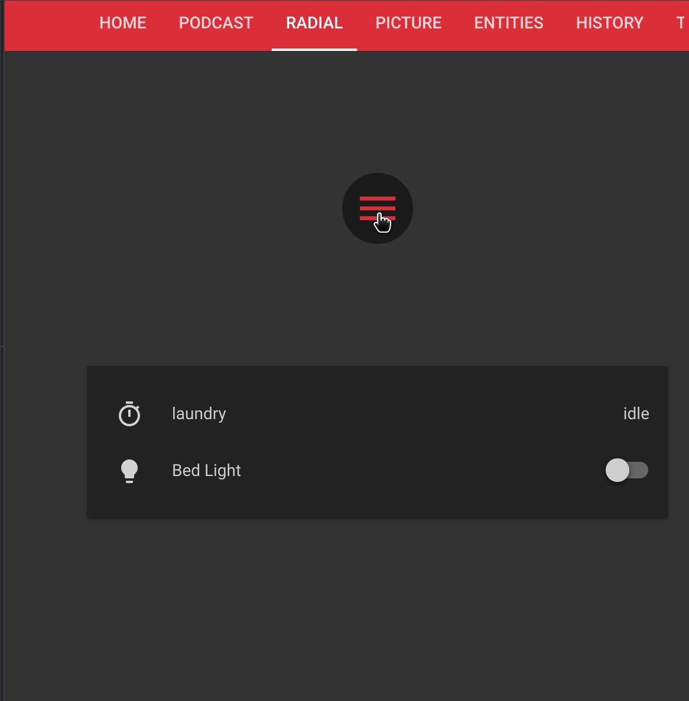

# ⭕ Lovelace Radial Menu Element

[![GitHub Release][releases-shield]][releases]
[![License][license-shield]](LICENSE.md)
[](https://github.com/custom-components/hacs)

![Project Maintenance][maintenance-shield]
[![GitHub Activity][commits-shield]][commits]

[![Discord][discord-shield]][discord]
[![Community Forum][forum-shield]][forum]

[![Twitter][twitter]][twitter]
[![Github][github]][github]

This element is for [Lovelace](https://www.home-assistant.io/lovelace) on [Home Assistant](https://www.home-assistant.io/) that provides a radial menu on click for quick/space saving access to commands. Designed for picture-elements, but can be used anywhere.

## Minimum Home Assistant Version

Home Assistant 2024.1.0 or higher is required.

## Support

Hey dude! Help me out for a couple of :beers: or a :coffee:!

[](https://www.buymeacoffee.com/zJtVxUAgH)



## Installation

Use [HACS](https://hacs.xyz) or follow this [guide](https://github.com/thomasloven/hass-config/wiki/Lovelace-Plugins)

```yaml
resources:
  - url: /local/radial-menu.js
    type: module
```

When installed with HACS the resource URL is `/hacsfiles/radial-menu/radial-menu.js`.

## Options

| Name                     | Type      | Requirement  | Description                                                                                             | Default               |
| ------------------------ | --------- | ------------ | ------------------------------------------------------------------------------------------------------- | --------------------- |
| `type`                   | `string`  | **Required** | `custom:radial-menu`                                                                                    | `none`                |
| `items`                  | `list`    | **Required** | List of items to display in the radial. See [item options](#item-options)                               | `none`                |
| `name`                   | `string`  | **Optional** | Tooltip for main menu                                                                                   | `menu`                |
| `icon`                   | `string`  | **Optional** | mdi icon for main menu                                                                                  | `mdi:menu`            |
| `entity_picture`         | `string`  | **Optional** | picture to display                                                                                      | `none`                |
| `default_open`           | `boolean` | **Optional** | Should the radial be expanded on first load                                                             | `false`               |
| `default_dismiss`        | `boolean` | **Optional** | Should the radial be dismissed on click of an item                                                      | `true`                |
| `close_on_outside_click` | `boolean` | **Optional** | Close the open menu when clicking or tapping anywhere outside of it                                     | `true`                |
| `entity`                 | `string`  | **Optional** | Home Assistant entity ID (used for `more-info` action)                                                  | `none`                |
| `tap_action`             | `map`     | **Optional** | Action to take on tap. See [action options](#action-options)                                            | `action: toggle-menu` |
| `hold_action`            | `map`     | **Optional** | Action to take on hold. See [action options](#action-options)                                           | `action: none`        |
| `double_tap_action`      | `map`     | **Optional** | Action to take on double tap. See [action options](#action-options)                                     | `action: none`        |
| `theme`                  | `string`  | **Optional** | Card theme                                                                                              |                       |
| `items_offset`           | `number`  | **Optional** | Distance of items from menu center, as a percentage of the menu size                                    | `35`                  |
| `size`                   | `string`  | **Optional** | Menu size as any CSS length (a plain number is pixels). Use `100%` to fill the parent and scale with it | `250px`               |
| `start_angle`            | `number`  | **Optional** | Angle of the first item in degrees, clockwise from 12 o'clock                                           | `0`                   |
| `arc`                    | `number`  | **Optional** | Degrees the items span. Below `360` the first and last items sit on the two ends of the arc             | `360`                 |

## Item Options

| Name                | Type     | Requirement  | Description                                                                            | Default             |
| ------------------- | -------- | ------------ | -------------------------------------------------------------------------------------- | ------------------- |
| `card`              | `map`    | **Optional** | A whole other Lovelace card configuration to build, centered on the item position.     | `none`              |
| `entity`            | `string` | **Optional** | Home Assistant entity ID.                                                              | `none`              |
| `name`              | `string` | **Optional** | Tooltip for the item                                                                   | `none`              |
| `icon`              | `string` | **Optional** | mdi icon for the item                                                                  | `none`              |
| `entity_picture`    | `string` | **Optional** | picture to display                                                                     | `none`              |
| `color`             | `string` | **Optional** | Icon color for this item (any CSS color). The hover color still applies while hovering | `none`              |
| `tap_action`        | `map`    | **Optional** | Action to take on tap. See [action options](#action-options)                           | `action: more-info` |
| `hold_action`       | `map`    | **Optional** | Action to take on hold. See [action options](#action-options)                          | `action: more-info` |
| `double_tap_action` | `map`    | **Optional** | Action to take on double tap. See [action options](#action-options)                    | `action: none`      |

## Action Options

| Name              | Type     | Supported options                                                                                 | Description                                                                                                                                            |
| ----------------- | -------- | ------------------------------------------------------------------------------------------------- | ------------------------------------------------------------------------------------------------------------------------------------------------------ |
| `action`          | `string` | `more-info`, `toggle`, `call-service`, `perform-action`, `navigate`, `url`, `toggle-menu`, `none` | Action to perform. Defaults are listed in the option tables above. `toggle-menu` opens or closes the menu and is the menu button's default tap action. |
| `entity`          | `string` | Any entity id                                                                                     | **Only valid for `action: more-info`** to override the entity on which you want to call `more-info`                                                    |
| `navigation_path` | `string` | Eg: `/lovelace/0/`                                                                                | Path to navigate to (e.g. `/lovelace/0/`) when action defined as navigate                                                                              |
| `url_path`        | `string` | Eg: `https://www.google.com`                                                                      | URL to open on click when action is `url`.                                                                                                             |
| `service`         | `string` | Any service                                                                                       | Service to call (e.g. `media_player.media_play_pause`) when `action` is `call-service`                                                                 |
| `service_data`    | `map`    | Any service data                                                                                  | Service data (e.g. `entity_id: media_player.bedroom`) when `action` is `call-service`. `data` works too.                                               |
| `perform_action`  | `string` | Any action                                                                                        | Action to perform (e.g. `light.turn_on`) when `action` is `perform-action`. This is what the visual editor writes.                                     |
| `data`            | `map`    | Any action data                                                                                   | Data for `perform-action` (or `call-service`)                                                                                                          |
| `target`          | `map`    | `entity_id`, `device_id`, `area_id`                                                               | Target for `perform-action` (or `call-service`)                                                                                                        |
| `haptic`          | `string` | `success`, `warning`, `failure`, `light`, `medium`, `heavy`, `selection`                          | Accepted for compatibility. The companion app's haptic feedback is sent by the action itself (`success` after `toggle` or a service call).             |

## Visual Editor

The card has a visual editor: add a card in the dashboard editor and choose Radial Menu. Menu options and regular items (icon, name, entity, actions, color) can be edited there. Items that use `card:` are YAML-only: the editor shows them read-only, so edit those in the YAML editor.

## Theme Variables

The following variables can be set in your theme (or on any parent element) to change the appearance of the radial menu. No `card_mod` is needed.

Values can be a color name, hexadecimal, rgb, rgba, hsl, hsla, basically anything supported by CSS.

| name                                  | Default                        | Description                                                                 |
| ------------------------------------- | ------------------------------ | --------------------------------------------------------------------------- |
| `--radial-icon-size`                  | `--mdc-icon-size`, else `24px` | Icon size                                                                   |
| `--radial-menu-button-color`          | `--primary-color`              | Main menu button color                                                      |
| `--radial-menu-item-color`            | `--primary-color`              | Item icon color                                                             |
| `--radial-menu-item-hover-color`      | `--accent-color`               | Icon item color on hover                                                    |
| `--radial-menu-item-hover-background` | `--secondary-background-color` | Background of picture items (`entity_picture`) and the menu button on hover |
| `--radial-menu-transition`            | `0.4s ease-out`                | Open/close transition (duration, easing)                                    |

A per-item `color` overrides the item color for that item only; the hover color still wins while hovering.

Set them in a theme (`themes.yaml`), without the leading `--`:

```yaml
my-theme:
  radial-menu-button-color: '#ff9800'
  radial-menu-item-color: 'var(--primary-text-color)'
  radial-menu-item-hover-color: 'var(--accent-color)'
  radial-menu-item-hover-background: 'rgba(255, 255, 255, 0.1)'
  radial-menu-transition: '0.2s ease-in-out'
  radial-icon-size: '32px'
```

Then select the theme for the dashboard, or for one menu with `theme: my-theme`.

You can also set them directly on the element, for example as the `style` of a `picture-elements` element:

```yaml
type: picture-elements
image: /local/floorplan.png
elements:
  - type: custom:radial-menu
    style:
      top: 50%
      left: 50%
      '--radial-menu-item-color': orange
      '--radial-icon-size': 30px
    items:
      - icon: mdi:lightbulb
        name: Light
        entity: light.bed_light
        tap_action:
          action: more-info
```

## Usage


Since 2.0 an open menu closes on a click outside it, so a menu meant to stay open sets `close_on_outside_click: false`, as below.

```yaml
type: 'custom:radial-menu'
icon: 'mdi:home'
name: 'Home'
default_open: true
default_dismiss: false
close_on_outside_click: false
size: 100%
hold_action:
  action: url
  url_path: https://www.home-assistant.io
items:
  - entity: light.bed_light
    icon: 'mdi:flash'
    name: Bedroom Light
    color: gold
    tap_action:
      action: toggle
      haptic: success
    hold_action:
      action: more-info
  - entity: alarm_control_panel.ha_alarm
    icon: 'mdi:alarm-light'
    name: Alarm Panel
    tap_action:
      action: more-info
  - icon: 'mdi:alarm'
    name: Timer
    tap_action:
      action: call-service
      service: timer.start
      service_data:
        entity_id: timer.laundry
      haptic: success
    hold_action:
      action: call-service
      service: timer.pause
      service_data:
        entity_id: timer.laundry
      haptic: success
  - entity_picture: '/local/headphones.png'
    name: Podcasts
    tap_action:
      action: navigate
      navigation_path: /lovelace/1
  - card:
      type: 'custom:button-card'
      entity: light.kitchen
      show_name: false
      styles:
        card:
          - background-color: 'rgba(0, 0, 0, 0)'
          - box-shadow: 0px 0px 0px 0px black
```

A half circle fanning out above the button:

```yaml
type: custom:radial-menu
icon: mdi:menu
start_angle: -90
arc: 180
items:
  - entity: light.bed_light
    icon: mdi:lightbulb
    tap_action:
      action: more-info
  - entity: fan.bedroom
    icon: mdi:fan
    tap_action:
      action: more-info
  - entity: media_player.tv
    icon: mdi:television
    tap_action:
      action: more-info
```

## Upgrading to 2.0

Existing configs keep working. Two behaviors changed on purpose:

1. Embedded `card:` items are now centered on their position point. In 1.6.0 they were offset by about 10px right and 25px down; that offset is gone, so cards may sit slightly differently than before.
2. `close_on_outside_click` is on by default for all configs. A menu with `default_open: true` that is meant to stay open now closes on a click outside it. To keep the old behavior set `close_on_outside_click: false`.

If you style card items with `card_mod`: each `card:` item is now wrapped in an outer `div.custom` that holds its position, with the card inside it. In 1.6.0 the `custom` class was on the card element itself, so rules targeting `.custom` now hit the wrapper rather than the card.

New in 2.0: `size`, `start_angle`, `arc`, per-item `color`, `close_on_outside_click`, `perform-action` actions, the `--radial-menu-item-hover-color`, `--radial-menu-item-hover-background` and `--radial-menu-transition` theme variables, and a visual editor.

[Troubleshooting](https://github.com/thomasloven/hass-config/wiki/Lovelace-Plugins)

Inspiration taken from [Creative Punch](https://codepen.io/CreativePunch/pen/lAHiu)

[commits-shield]: https://img.shields.io/github/commit-activity/y/iantrich/radial-menu.svg?style=for-the-badge
[commits]: https://github.com/iantrich/radial-menu/commits/master
[discord]: https://discord.gg/Qa5fW2R
[discord-shield]: https://img.shields.io/discord/330944238910963714.svg?style=for-the-badge
[forum-shield]: https://img.shields.io/badge/community-forum-brightgreen.svg?style=for-the-badge
[forum]: https://community.home-assistant.io/t/lovelace-radial-menu-element/111210
[license-shield]: https://img.shields.io/github/license/iantrich/radial-menu.svg?style=for-the-badge
[maintenance-shield]: https://img.shields.io/badge/maintainer-Ian%20Richardson%20%40iantrich-blue.svg?style=for-the-badge
[releases-shield]: https://img.shields.io/github/release/iantrich/radial-menu.svg?style=for-the-badge
[releases]: https://github.com/iantrich/radial-menu/releases
[twitter]: https://img.shields.io/twitter/follow/iantrich.svg?style=social
[github]: https://img.shields.io/github/followers/iantrich.svg?style=social
